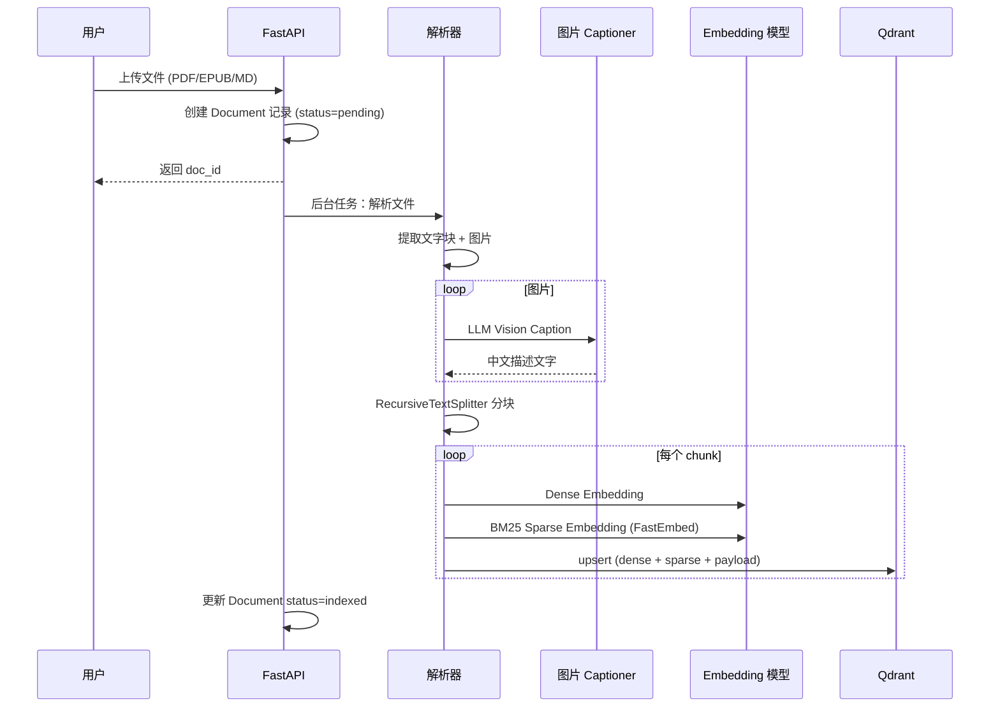
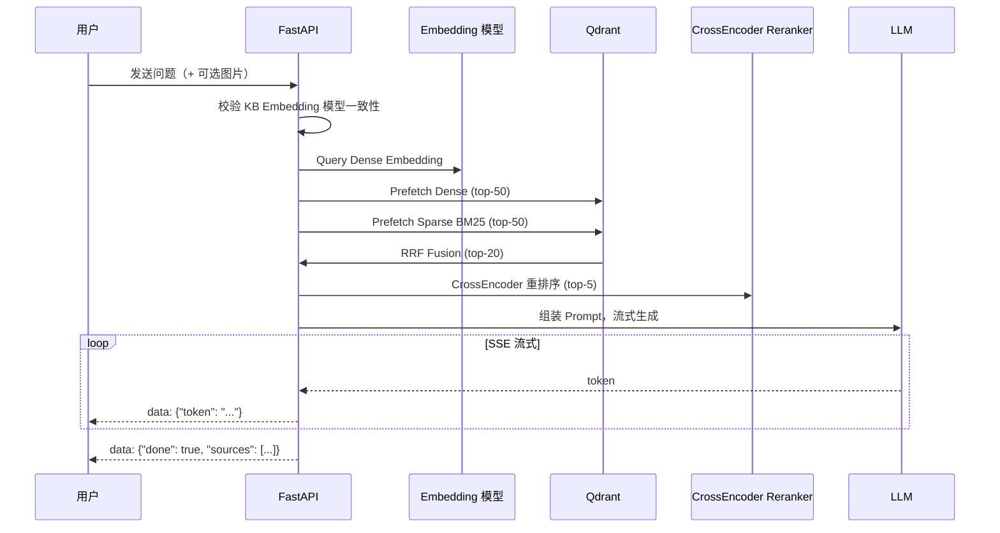
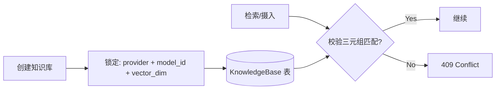

# 系统架构

## 整体架构

```mermaid
graph TB
    subgraph 客户端层
        WEB[React 前端<br/>Tailwind + Zustand]
        CLI[CLI 终端工具<br/>Typer + Rich]
    end

    subgraph API 层
        FASTAPI[FastAPI<br/>REST + SSE 流式]
        CORS[CORS / Proxy]
    end

    subgraph RAG 核心
        INGEST[摄入流水线<br/>parse → chunk → caption → embed → index]
        RETRIEVAL[混合检索<br/>Dense + Sparse BM25 + RRF]
        PIPELINE[RAG Pipeline<br/>检索 → Prompt → LLM 流式生成]
    end

    subgraph 存储层
        QDRANT[(Qdrant 向量库<br/>密集 + 稀疏双向量)]
        DB[(SQLite / PostgreSQL<br/>元数据 + 会话历史)]
        FS[文件系统<br/>原文件 + 图片缓存]
    end

    subgraph 模型层
        subgraph Embedding
            EMB_DOUBAO[豆包 Embedding<br/>doubao-embedding-*]
            EMB_OLLAMA[Ollama Embedding]
            EMB_VLLM[vLLM Embedding]
        end
        subgraph LLM
            LLM_DOUBAO[豆包 Chat<br/>doubao-seed-*]
            LLM_DEEPSEEK[DeepSeek<br/>deepseek-chat/coder]
            LLM_OLLAMA[Ollama<br/>llama3 / llava]
            LLM_VLLM[vLLM]
        end
    end

    subgraph 微调模块（可选）
        FT_DATA[数据准备<br/>QA 对生成]
        FT_TRAIN[Unsloth LoRA 训练]
        FT_EXPORT[导出 GGUF → Ollama]
    end

    WEB --> CORS --> FASTAPI
    CLI --> FASTAPI
    FASTAPI --> INGEST
    FASTAPI --> PIPELINE
    INGEST --> QDRANT
    INGEST --> DB
    INGEST --> FS
    RETRIEVAL --> QDRANT
    PIPELINE --> RETRIEVAL
    PIPELINE --> LLM_DOUBAO
    PIPELINE --> LLM_DEEPSEEK
    PIPELINE --> LLM_OLLAMA
    PIPELINE --> LLM_VLLM
    INGEST --> EMB_DOUBAO
    INGEST --> EMB_OLLAMA
    INGEST --> EMB_VLLM
    FT_DATA --> FT_TRAIN --> FT_EXPORT --> LLM_OLLAMA
```

## 数据摄入流程



## 检索与 RAG 流程



## Embedding 模型锁定机制



> **设计原则**: 向量空间由 Embedding 模型决定。若在摄入阶段和检索阶段使用了不同模型，
> 向量无法对齐，检索结果将完全错误（静默失败）。因此系统强制要求 Embedding 模型不可变。
