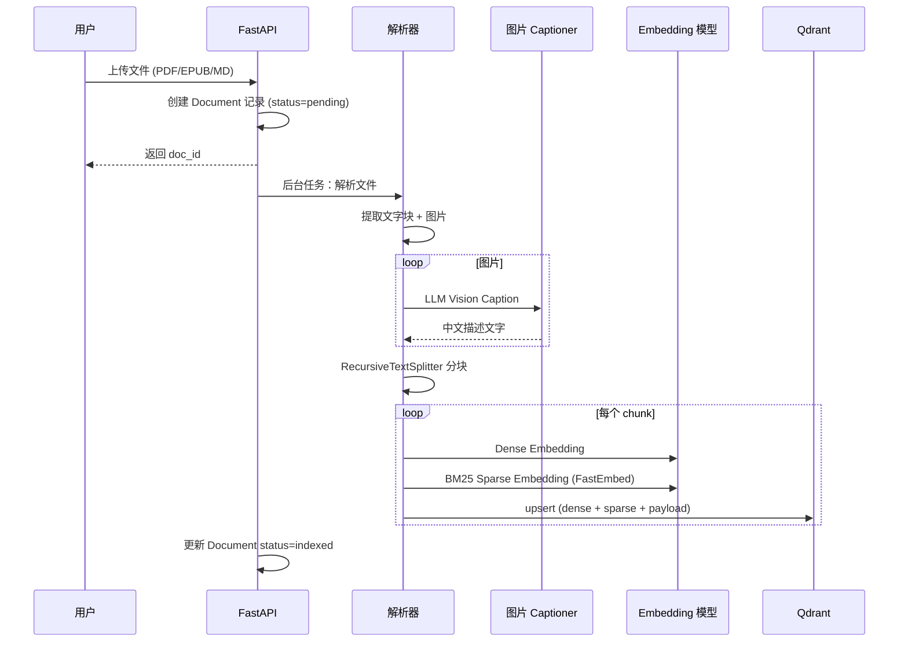
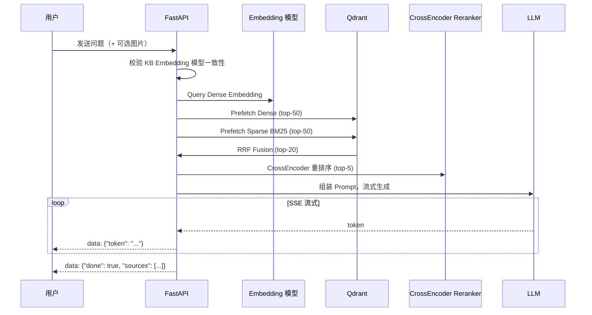
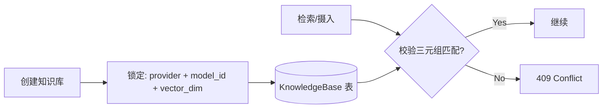

# 系统架构

## 整体架构

```mermaid
graph TB
    subgraph 客户端层
        WEB[React 前端<br/>Tailwind + Zustand]
        CLI[CLI 终端工具<br/>Typer + Rich]
    end

    subgraph API 层
        FASTAPI[FastAPI<br/>REST + SSE 流式]
        CORS[CORS / Proxy]
    end

    subgraph RAG 核心
        INGEST[摄入流水线<br/>parse → chunk → caption → embed → index]
        RETRIEVAL[混合检索<br/>Dense + Sparse BM25 + RRF]
        PIPELINE[RAG Pipeline<br/>检索 → Prompt → LLM 流式生成]
    end

    subgraph 存储层
        QDRANT[(Qdrant 向量库<br/>密集 + 稀疏双向量)]
        DB[(SQLite / PostgreSQL<br/>元数据 + 会话历史)]
        FS[文件系统<br/>原文件 + 图片缓存]
    end

    subgraph 模型层
        subgraph Embedding
            EMB_DOUBAO[豆包 Embedding<br/>doubao-embedding-*]
            EMB_OLLAMA[Ollama Embedding]
            EMB_VLLM[vLLM Embedding]
        end
        subgraph LLM
            LLM_DOUBAO[豆包 Chat<br/>doubao-seed-*]
            LLM_DEEPSEEK[DeepSeek<br/>deepseek-chat/coder]
            LLM_OLLAMA[Ollama<br/>llama3 / llava]
            LLM_VLLM[vLLM]
        end
    end

    subgraph 微调模块（可选）
        FT_DATA[数据准备<br/>QA 对生成]
        FT_TRAIN[Unsloth LoRA 训练]
        FT_EXPORT[导出 GGUF → Ollama]
    end

    WEB --> CORS --> FASTAPI
    CLI --> FASTAPI
    FASTAPI --> INGEST
    FASTAPI --> PIPELINE
    INGEST --> QDRANT
    INGEST --> DB
    INGEST --> FS
    RETRIEVAL --> QDRANT
    PIPELINE --> RETRIEVAL
    PIPELINE --> LLM_DOUBAO
    PIPELINE --> LLM_DEEPSEEK
    PIPELINE --> LLM_OLLAMA
    PIPELINE --> LLM_VLLM
    INGEST --> EMB_DOUBAO
    INGEST --> EMB_OLLAMA
    INGEST --> EMB_VLLM
    FT_DATA --> FT_TRAIN --> FT_EXPORT --> LLM_OLLAMA
```

## 数据摄入流程



## 检索与 RAG 流程



## Embedding 模型锁定机制



> **设计原则**: 向量空间由 Embedding 模型决定。若在摄入阶段和检索阶段使用了不同模型，
> 向量无法对齐，检索结果将完全错误（静默失败）。因此系统强制要求 Embedding 模型不可变。

## 运行时模型与运维边界

### 进程与任务

- API 进程只做请求处理；文档摄入由进程内的 worker 协程消费 **数据库队列**（`documents` 表）。
- 认领任务时写入租约（`lease_until` + `attempts`），执行期间定期续租：
  - 进程崩溃/被杀 → 租约过期 → 文档自动回到 `pending`，下次启动继续处理；
  - 失败按指数退避重试（15s/30s/60s…上限 300s），超过 `INGEST_MAX_ATTEMPTS` 落 `failed`；
  - PostgreSQL 使用 `FOR UPDATE SKIP LOCKED`，多副本可安全并行消费；SQLite 为单机模式。
- 并发上限由 `INGEST_WORKERS` 控制，避免一次上传几十个文件把 embedding 服务打满。
- 关闭时先停止认领，给在跑任务 `SHUTDOWN_GRACE_SECONDS` 收尾；超时才强制取消。

### 探针

| 路径 | 用途 | 行为 |
| --- | --- | --- |
| `/healthz` | 存活探针 | 只要进程能响应就 200，不查依赖 |
| `/readyz` | 就绪探针 | DB + Qdrant 都可用才 200，否则 503，网关据此摘流量 |

模型服务（Ollama/DeepSeek/Rerank）的连通性仍由 `/api/v1/config/health` 暴露，供设置页展示，
不参与编排器探针，避免外部依赖抖动导致容器反复重启。

### 日志与请求追踪

- `LOG_FORMAT=json` 时输出单行 JSON，含 `request_id`、`method`、`path`、`status`、`duration_ms`。
- 每个请求都会返回 `X-Request-ID`（网关传入则透传），可与 nginx/网关日志串联。
- 未捕获异常统一返回 `{"detail": "服务器内部错误", "request_id": "..."}`，堆栈只进日志。

### 可选访问控制

设置 `API_TOKEN` 后，所有 `/api/*` 与 `/images/*` 请求需带 `Authorization: Bearer <token>`
（`/healthz`、`/readyz`、`/docs` 放行）。前端构建时用 `VITE_API_TOKEN` 注入同一个值。

### 已知的横向扩容限制

以下状态仍在进程内存里，默认部署是单 worker（`WEB_CONCURRENCY=1`）：

- 调试模式 trace（`core/observability/trace.py`，另有落盘副本）
- 摄入进度（`tasks/progress.py`）

要扩到多 worker/多副本，需要先把这两处换成 Redis/PG 共享存储；DB 队列本身不受影响。
